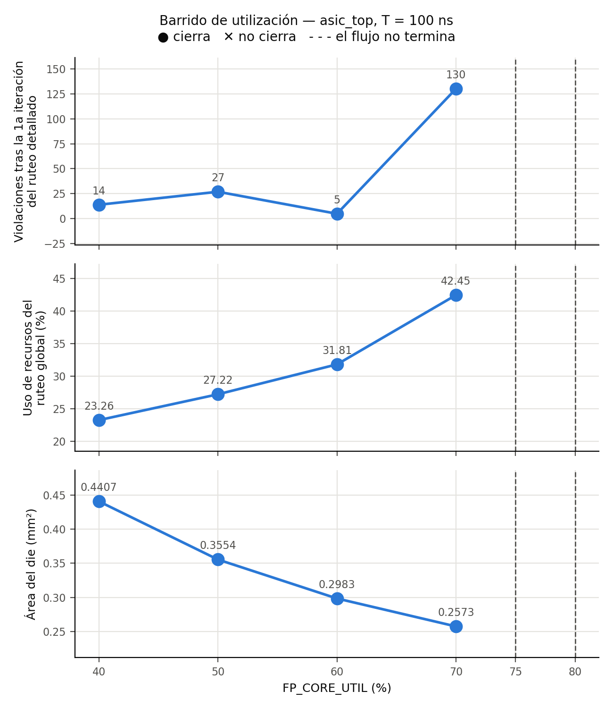

# 3.5 Floorplan, alimentación, placement y costo

Corridas de `flow/asic_top` (estrategia de memoria ROM, `CLOCK_PERIOD` = 100 ns) con
los pines por función de `flow/asic_top/pin_order.cfg`, variando solo `FP_CORE_UTIL`.

```bash
scripts/run_sweep.sh -s pines -p "100" -u "40 50 60 70 75 80"
python3 scripts/floorplan.py -o results/floorplan.csv -g results/floorplan.png \
  flow/asic_top/runs/CP100_U*_pines
```

> Números con el RTL al 1/11 (antes del contador como módulo propio y de la
> optimización de la ruta crítica). Se regeneran con los mismos comandos sobre la
> corrida final.

## Terminales del macro

| Lado | Terminales | Por qué ahí |
|---|---|---|
| Oeste | `rst_ni`, `clk_i` | Señales globales, solas en un lado: la raíz del árbol de reloj parte del borde sin compartirlo con buses de datos, y el reset entra junto al reloj al sincronizador de `pochoco_soc` |
| Sur | `btn_i[3:0]`, `led_o[3:0]` | La interfaz de usuario: los dos buses terminan en el mismo bloque (`pochoco_periph`: `debounce_bank` y registro de LEDs), así que conviene que entren juntos |
| Norte | `seg1_o[6:0]`, `seg2_o[6:0]` | El bus más ancho (14 salidas) con un lado propio, cada display con sus 7 segmentos contiguos y en orden, para que quien integre el macro los rutee sin cruces |
| Este | `spi_cs_ni`, `spi_sclk_i`, `spi_mosi_i`, `spi_miso_o` | Interfaz independiente (`pochoco_spi_slave`), separada del resto |

`ERRORS_ON_UNMATCHED_IO = both`: el flujo se detiene si un puerto no aparece en el
archivo o si el archivo nombra un puerto que no existe.

**Terminales de macro vs. pads de I/O.** Estos terminales son solo rectángulos de metal
en el borde (Metal2 en los lados norte/sur, Metal3 en este/oeste, `IO_PIN_V_LAYER`/
`IO_PIN_H_LAYER`), sin circuitos: los maneja directamente una celda estándar del macro.
En un chip completo cada señal pasaría por una celda de pad (`gf180mcu_fd_io`) con
protección ESD, buffers de salida capaces de cargar una pista de PCB y un bondpad, más
pads de alimentación, todos en un anillo alrededor del core. Ese anillo ocupa mucho más
que este macro entero y fija el orden de los pines según el encapsulado, no según la
lógica.

## Barrido de utilización

| `FP_CORE_UTIL` | Die (µm) | Die (mm²) | Util. final | Uso ruteo global | Violaciones DRT iter. 0 | Setup WS ss (ns) | Hold WS ss (ns) | ¿Cierra? | Costo (US$) |
|---|---|---|---|---|---|---|---|---|---|
| 40 % | 655,0 × 672,9 | 0,4407 | 51,4 % | 23,26 % | 14 | 37,56 | 0,95 | sí | 10.136 |
| 50 % | 587,3 × 605,2 | 0,3554 | 63,5 % | 27,22 % | 27 | 36,50 | 0,93 | sí | 8.174 |
| 60 % | 537,3 × 555,2 | 0,2983 | 75,5 % | 31,81 % | 5 | 39,82 | 0,99 | sí | 6.861 |
| **70 %** | **498,4 × 516,3** | **0,2573** | 87,6 % | 42,45 % | 130 | 41,28 | 1,00 | **sí** | **5.918** |
| 75 % | — | — | — | — | — | — | — | no: el flujo no termina | — |
| 80 % | — | — | — | — | — | — | — | no: el flujo no termina | — |

Fuente: `results/floorplan.csv`. "Util. final" es la utilización después de buffering y
CTS (`design__instance__utilization`), mayor que el `FP_CORE_UTIL` pedido porque el
repair de diseño agrega ~780 buffers después del floorplan. En todas las que cierran:
Magic DRC 0, LVS 0, antena 0, setup y hold con WS ≥ 0 y TNS = 0 en los 9 corners.



**Área mínima que cierra: `FP_CORE_UTIL` = 70 %, die de 0,2573 mm².** A 75 % y 80 % el
flujo se detiene antes de rutear porque no queda espacio para legalizar celdas que el
flujo agrega después del placement:

- 80 %: `flow/asic_top/runs/CP100_U80_pines/32-openroad-repairdesignpostgpl/openroad-repairdesignpostgpl.log:50`
  (`DPL-0034`, 34 instancias sin lugar, entre ellas los buffers `max_cap*` recién
  insertados) y `:85` (`DPL-0036 Detailed placement failed`).
- 75 %: pasa el repair de diseño pero falla igual al legalizar los buffers del árbol de
  reloj: `flow/asic_top/runs/CP100_U75_pines/35-openroad-cts/openroad-cts.log:109`
  (12 instancias) y `:122` (`DPL-0036`).

La congestión crece con la utilización: el uso de recursos del ruteo global sube de
23 % a 42 % y las violaciones que deja la primera iteración del ruteo detallado saltan a
130 en 70 % (entre 40 % y 60 % son ruido, 5 a 27). El ruteador las resuelve en todas
las corridas que terminan (0 al final), pero el margen a 70 % es chico. El timing casi no
cambia (a 100 ns sobra holgura en todos los puntos); el límite lo pone el espacio para
las celdas, no el timing ni el ruteo.

## Costo

Con US$23.000/mm² escalando linealmente con el área del die:

- Corrida exigida (U = 40 %): 0,4407 mm² → **US$10.136**.
- Área mínima que cierra (U = 70 %): 0,2573 mm² → **US$5.918** (−42 %).

Limitaciones de la aproximación:
- Es solo el macro: un chip real necesita el anillo de pads, que para un diseño tan
  chico ocupa más área que el core (el die quedaría limitado por los pads, no por la
  lógica).
- El costo real no es lineal: hay costos fijos (máscaras, diseño, verificación) que no
  dependen del área, y en un shuttle multiproyecto se compra un slot de tamaño mínimo.
- No incluye rendimiento (yield): la probabilidad de un defecto crece con el área, y
  tampoco el corte del wafer, encapsulado ni test.
- Es para un nodo y un proceso fijos (GF180MCU); no sirve para extrapolar a otro nodo.

**Decisión que más pesó en el área.** Dimensionar la memoria al uso real del juego. Con
la RAM de 512 palabras del Proyecto 2 la síntesis ya daba 2,31 mm² solo de celdas
(`flow/asic_top/runs/01_regfile_ff`, ver `docs/evidencia.md` #3), contra 0,205–0,211 mm²
de celdas con la ROM (≈ 11 veces menos). La utilización vino después y solo mueve el die
dentro de un factor ~1,7 (0,44 → 0,26 mm²). Comparación con la estrategia de
flip-flops: ver `docs/memoria.md`.
