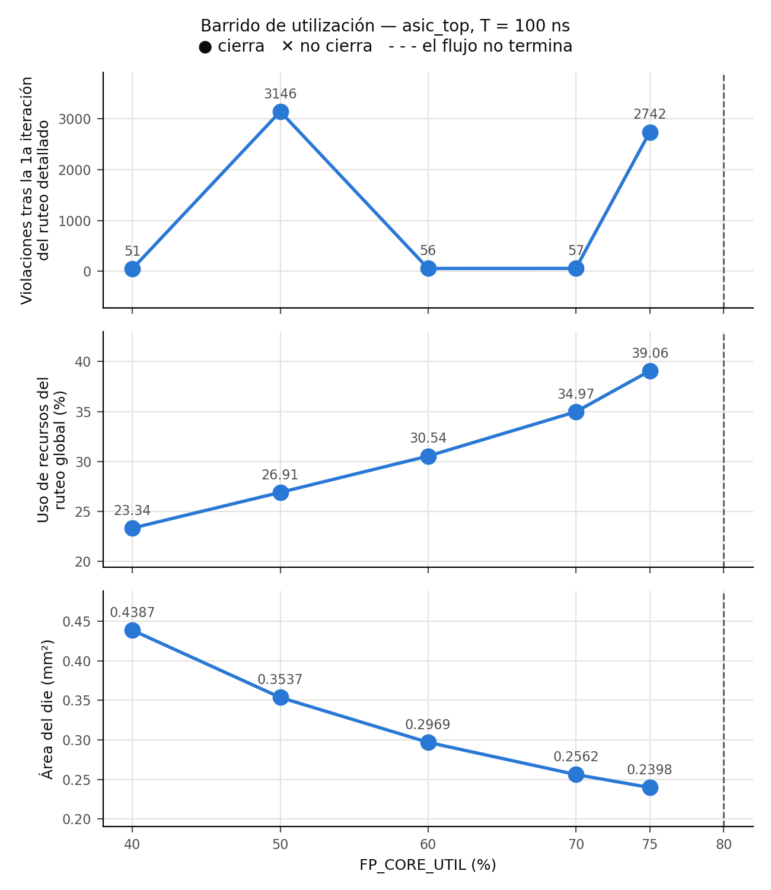

# 3.5 Floorplan, alimentación y placement

Todas las corridas usan el RTL final (memoria ROM, contador como módulo, `boff_q` en el
LSU), `CLOCK_PERIOD` = 100 ns y el mismo `flow/asic_top/config.json`; solo cambia
`FP_CORE_UTIL`.

```bash
scripts/run_sweep.sh -s final -p "100" -u "40 50 60 70 75 80"
python3 scripts/floorplan.py -o results/floorplan.csv -g results/floorplan.png \
  flow/asic_top/runs/CP100_U*_final
```

## Floorplan

LibreLane dimensiona el core a partir del área de celdas que sale de la síntesis
(`FP_SIZING = relative`): core = área de celdas / `FP_CORE_UTIL`, cuadrado
(`FP_ASPECT_RATIO = 1`), y le suma un margen hasta el borde del die. Con U = 40 % el die
mide 653,44 × 671,36 µm (0,4387 mm²). Después del floorplan se insertan las *tap cells*
(cada `FP_TAPCELL_DIST` = 20 µm, conectan pozo y sustrato a la alimentación para evitar
*latch-up*) y las *endcaps* en los extremos de cada fila.

La **utilización final** (48,0 % en la corrida final) es mayor que el `FP_CORE_UTIL`
pedido, porque después del floorplan el flujo agrega buffers de repair, el árbol de reloj
y la corrección de hold, y todo eso ocupa área dentro del mismo core.

## Alimentación (PDN)

La red de alimentación la genera OpenROAD (`21-openroad-generatepdn`) con la
configuración por defecto de LibreLane para GF180:

| Nivel | Capa | Geometría |
|---|---|---|
| Rieles de las filas | Metal1 | 0,6 µm de ancho, uno por fila de celdas (VDD y VSS alternados) |
| Straps verticales | Metal4 | 1,6 µm de ancho, paso 153,6 µm |
| Straps horizontales | Metal5 | 1,6 µm de ancho, paso 153,18 µm |

Los rieles de Metal1 alimentan a las celdas; los straps de Metal4/Metal5 forman una
malla que lleva la corriente desde los terminales `VDD`/`VSS` del macro hasta los rieles,
con vías en cada cruce. **No hay anillo de alimentación** (`PDN_CORE_RING = False`): el
macro expone la malla como pines (`PDN_ENABLE_PINS`), y quien lo integre la conecta a la
red del chip.

Verificación en la corrida final:

- 0 violaciones de la red de alimentación (`design__power_grid_violation__count`, etapa
  `30-checker-powergridviolations`): todos los segmentos de VDD y VSS están conectados
  (`PSM-0040`).
- IR drop estático en `nom_tt` (`56-openroad-irdropreport/irdrop.rpt`): peor caída
  0,143 mV en VDD y 0,097 mV en VSS, con una alimentación de 5 V. Es despreciable porque
  el diseño consume poco: 13,0 mW en total según `final/metrics.json` (`power__total`),
  de los cuales 10,1 mW son internos, 2,9 mW de conmutación y 2,4 µW de fuga.

## Terminales del macro

`flow/asic_top/pin_order.cfg` agrupa los terminales por función, un lado por grupo. Con
`ERRORS_ON_UNMATCHED_IO = both`, el flujo se detiene si falta un puerto o si sobra uno.

| Lado | Terminales | Por qué ahí |
|---|---|---|
| Oeste | `rst_ni`, `clk_i` | Señales globales con un lado propio: la raíz del árbol de reloj parte del borde sin competir con buses de datos, y el reset entra junto al reloj al sincronizador |
| Sur | `btn_i[3:0]`, `led_o[3:0]` | Interfaz de usuario: ambos buses terminan en `pochoco_periph` (debouncer y registro de LEDs) |
| Norte | `seg1_o[6:0]`, `seg2_o[6:0]` | El bus más ancho (14 salidas), cada display con sus 7 segmentos contiguos y en orden, para rutearlos sin cruces al integrar el macro |
| Este | `spi_cs_ni`, `spi_sclk_i`, `spi_mosi_i`, `spi_miso_o` | Interfaz independiente (`pochoco_spi_slave`) |

Los terminales son rectángulos de metal en el borde del macro (Metal2 en norte y sur,
Metal3 en este y oeste), sin ningún circuito propio: los maneja directamente una celda
estándar interna. **Un chip completo usaría pads de I/O**: cada señal pasaría por una
celda de pad (`gf180mcu_fd_io`) con protección ESD, un driver capaz de cargar una pista
de PCB y un *bondpad* para el cable de conexión, más pads dedicados de alimentación, todos
en un anillo alrededor del core. En un chip el orden de los pads lo fija el encapsulado y
la placa. En un macro, en cambio, se elige para facilitar el ruteo hacia el resto del
chip.

## Barrido de utilización

| `FP_CORE_UTIL` | Die (µm) | Die (mm²) | Util. final | Uso ruteo global | Viol. DRT iter. 0 | Setup WS ss (ns) | Hold WS peor (ns) | ¿Cierra? | Costo (US$) |
|---|---|---|---|---|---|---|---|---|---|
| 40 % | 653,4 × 671,4 | 0,4387 | 48,0 % | 23,34 % | 51 | 51,40 | 0,143 | sí | 10.090 |
| 50 % | 585,9 × 603,8 | 0,3537 | 59,0 % | 26,91 % | 3.146 | 53,37 | 0,120 | sí | 8.136 |
| 60 % | 536,0 × 553,9 | 0,2969 | 70,2 % | 30,54 % | 56 | 52,89 | 0,138 | sí | 6.829 |
| 70 % | 497,2 × 515,2 | 0,2562 | 81,6 % | 34,97 % | 57 | 51,88 | 0,120 | sí | 5.892 |
| **75 %** | **480,8 × 498,8** | **0,2398** | 86,9 % | 39,06 % | 2.742 | 51,25 | 0,124 | **sí** | **5.516** |
| 80 % | — | — | — | — | — | — | — | no: el flujo no termina | — |

Fuente: `results/floorplan.csv`. En todas las que cierran: DRC Magic y KLayout 0, LVS 0,
antena 0, setup y hold con WS ≥ 0 y TNS = 0 en los 9 corners.



**Área mínima que cierra: `FP_CORE_UTIL` = 75 %, die de 0,2398 mm²** (480,8 × 498,8 µm).
A 80 % el flujo se detiene en CTS, antes de rutear: `DPL-0034`, 10 instancias que no se
pueden legalizar (3 del register file), y `DPL-0036 Detailed placement failed`
(`CP100_U80_final/35-openroad-cts/openroad-cts.log:109` y `:120`).

**Análisis.**

- **Congestión.** El uso de recursos del ruteo global crece de forma monótona con la
  utilización, de 23 % a 39 %: hay más cables en menos área. Es la métrica de congestión
  más limpia del barrido.
- **Violaciones del ruteo detallado.** Las que quedan tras la primera iteración **no**
  siguen una tendencia (51, 3.146, 56, 57, 2.742): dependen de cómo quedó el placement en
  cada punto, y el ruteador las lleva a 0 en todas las corridas que terminan. Muestran el
  trabajo extra del ruteador, no un límite.
- **Timing.** Casi no cambia: el setup en ss está entre 51 y 53 ns en todos los puntos,
  porque a 100 ns sobra holgura.
- **Qué limita.** El **espacio para legalizar celdas**. A 80 % el placement inicial cabe,
  pero las celdas que se agregan después (buffers del árbol de reloj) ya no encuentran
  lugar libre en las filas.

En un barrido anterior, con las celdas de retardo `dly*` todavía permitidas, 75 % también
fallaba en CTS. Lo más probable es que fuera por el tamaño de esas celdas: `repair_design`
usaba `dlyb_1` como buffer, y ocupa 2,7 veces el área de un `buf_1` (detalle en
`docs/floorplan.md`).

## Costo

A US$23.000/mm², escalando linealmente con el área del die:

- Corrida exigida (U = 40 %): 0,4387 mm² → **US$10.090**.
- Área mínima que cierra (U = 75 %): 0,2398 mm² → **US$5.516** (−45 %).

**Limitaciones de la aproximación:**

- **Es solo el macro.** Un chip real necesita el anillo de pads, que en un diseño tan
  chico ocuparía más área que el core: el die quedaría limitado por los pads y no por la
  lógica.
- **El costo no es lineal.** Hay costos fijos (máscaras, diseño, verificación) que no
  dependen del área, y en un shuttle multiproyecto se compra un espacio de tamaño mínimo.
- **No incluye rendimiento** (la probabilidad de un defecto crece con el área), ni corte
  del wafer, encapsulado o test.
- **Vale solo para GF180MCU**; no sirve para extrapolar a otro nodo.

**Decisión que más pesó en el área y el costo: dimensionar la memoria al uso real del
juego.** Con la RAM de 512 palabras del Proyecto 2, la síntesis ya daba 2,31 mm² solo de
celdas (`flow/asic_top/runs/01_regfile_ff`, sección 3.1). Con la ROM, la corrida final
tiene 0,196 mm² de celdas, unas 12 veces menos. Entre las dos estrategias de 3.2,
comparadas con el mismo RTL y la misma configuración (`results/memoria.csv`), la de
flip-flops da un die de 1,571 mm² (US$36.133) y la ROM uno de 0,4407 mm² (US$10.137): 3,6
veces más. La
utilización viene después y solo mueve el die dentro de un factor ~1,8 (0,439 → 0,240 mm²).
