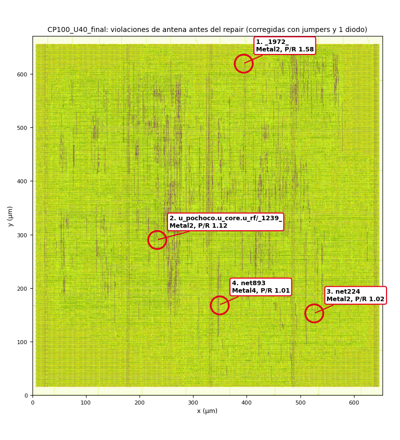
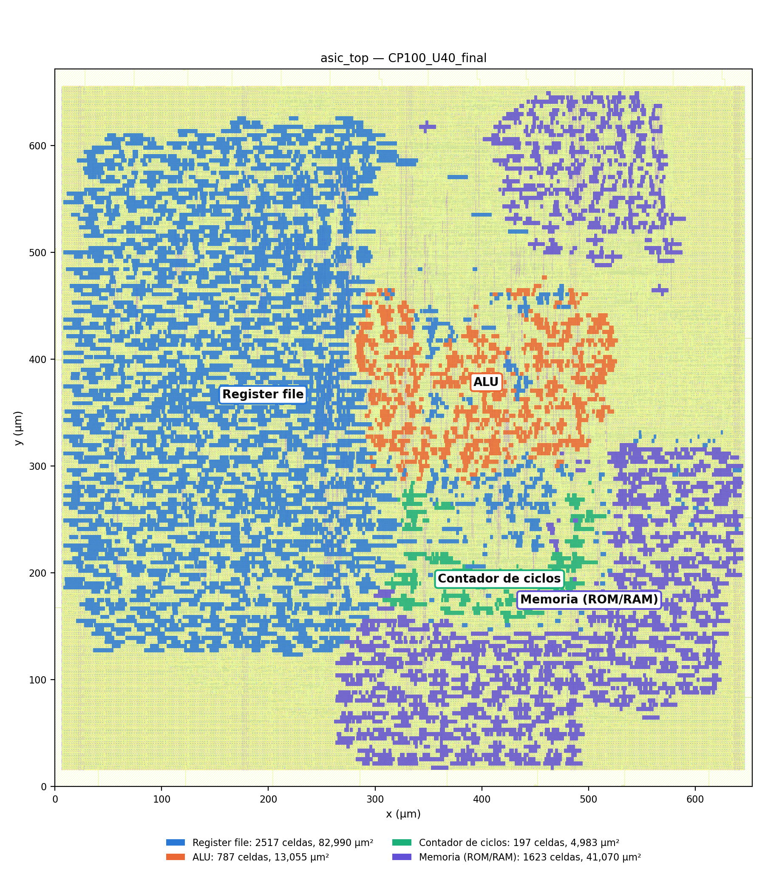

# 3.6 Signoff y layout

Corrida final `flow/asic_top/runs/CP100_U40_final` (T = 100 ns, U = 40 %, memoria
ROM). Detalle completo y rutas de cada reporte en `docs/signoff.md`.

## Resultado del signoff

| Chequeo | Resultado | Reporte (en la carpeta de la corrida) |
|---|---|---|
| DRC Magic | **0** | `64-magic-drc/reports/drc.magic.rpt` |
| DRC KLayout (558 reglas del PDK) | **0** | `65-klayout-drc/reports/drc.klayout.json` |
| XOR entre el GDS de Magic y el de KLayout | **0** diferencias | `final/metrics.json` |
| LVS (Netgen) | **"Circuits match uniquely"** | `70-netgen-lvs/reports/lvs.netgen.rpt` |
| Antena (final) | **0** redes, 0 pines | `46-openroad-checkantennas-1/reports/antenna_summary.rpt` |
| Setup / hold (9 corners) | WS ≥ 0, TNS = 0 | `55-openroad-stapostpnr/summary.rpt` |

**Dos DRC independientes.** Con `gf180mcuD`, LibreLane trae `KLAYOUT_DRC_RUNSET` sin
definir y salta el DRC de KLayout; en las primeras corridas, el "DRC Passed" venía solo
de Magic. Se habilitó el runset del PDK (`libs.tech/klayout/tech/drc/gf180mcu.drc`, con
la variante de metalización de `gf180mcuD`: 5 metales, metal superior de 11 kÅ, MIM
opción B). En la corrida final ejecuta 558 reglas (FEOL, BEOL, conectividad y
*off-grid*) sin violaciones, y coincide con Magic sobre el mismo GDS.

**LVS** compara el netlist extraído del layout con el netlist de PnR. Coinciden 1 a 1,
incluidos los 3 diodos de antena que agregó el repair.

## Violación de antena durante el desarrollo

### En la corrida final: 4 violaciones, corregidas por el flujo

Después del ruteo global, `40-openroad-checkantennas` encontró **4 redes que violan la
regla de antena** (razón de área lateral máxima 400):

| # | Red | Pin | Capa | Razón / máx. | Posición (µm) | Zona del layout |
|---|---|---|---|---|---|---|
| 1 | `_1972_` | `fanout29/I` | Metal2 | 633,66 / 400 | (393,7; 619,4) | borde norte, entre el register file y la memoria |
| 2 | `u_pochoco.u_core.u_rf/_1239_` | `u_rf/fanout296/I` | Metal2 | 446,64 / 400 | (232,4; 290,1) | dentro del register file (mux de lectura) |
| 3 | `net224` | `fanout223/I` | Metal2 | 406,35 / 400 | (525,8; 152,9) | zona sur de la memoria |
| 4 | `net893` | `fanout878/I` | Metal4 | 402,02 / 400 | (348,9; 168,6) | red de reset, debajo del contador |

Fuente: `40-openroad-checkantennas/reports/antenna_summary.rpt`; posiciones de las celdas
en `final/def/asic_top.def`. Figura: `python3 scripts/antenas_layout.py`.

**Qué es.** Mientras se fabrican las capas de metal, el grabado por plasma deposita
carga en los conductores. Si un tramo de metal está conectado solo a la compuerta de un
transistor (todavía no hay difusión que lo descargue) y su área es mucho mayor que la de
esa compuerta, el voltaje acumulado puede romper el óxido de compuerta. Las 4 redes son
tramos largos que terminan en la entrada de un `buf_1`, que tiene una compuerta chica.

**Cómo se resolvió** (`42-openroad-repairantennas`, log de
`1-openroad-diodeinsertion`):

1. 4 violaciones → **3 jumpers** en 3 redes. Un jumper parte el tramo largo con un
   puente a una capa superior: mientras se fabrican las capas inferiores, la compuerta
   queda conectada a un tramo más corto. Queda 1 violación.
2. 1 violación → **1 diodo de antena** junto al pin, que descarga la carga a sustrato.
   Al reacomodar aparecen 2 violaciones nuevas.
3. 2 violaciones → **2 jumpers más** → 0.

El chequeo final, después del ruteo detallado (`46-openroad-checkantennas-1`), da 0.

### En la memoria de flip-flops: 1 violación que no se pudo corregir

La corrida de la estrategia 2 (`flow/asic_top_ff/runs/CP100_U40_ff`, sección 3.2) es un
caso donde la corrección automática no alcanzó:

- Tras el ruteo global había **125 redes** con violación. El repair las bajó a 0 con 157
  jumpers y 145 diodos (159 → 108 → 91 → 12 → 5 → 3 → 0).
- **El ruteo detallado posterior volvió a crear 1**: `net4125` → `fanout4124/I`,
  Metal2, 472,61 / 400, en (968,2; 109,8) µm, cerca del borde sur
  (`46-openroad-checkantennas-1/reports/antenna_summary.rpt`).

La causa es que el repair de antenas trabaja sobre el ruteo **global**. El ruteo
detallado puede cambiar el recorrido de una red, y en un diseño tan congestionado
cambió el de esta y dejó otra vez un tramo largo de Metal2. Por esa sola violación, la
estrategia de flip-flops **no cierra** con el criterio del enunciado. No se corrigió
porque la estrategia elegida fue la ROM. Las opciones habrían sido subir
`GRT_ANTENNA_REPAIR_MARGIN` para que el repair deje más holgura, o insertar un diodo en
ese pin.

## Violaciones fuera del criterio: max slew, cap y fanout

LibreLane también reporta transiciones mayores a 3 ns (**max slew**), capacitancia y
fanout excesivos. No son parte del criterio de cierre y LibreLane no las trata como
error, pero se analizaron:

| Corner | Max slew | Max cap |
|---|---:|---:|
| `nom_tt_025C_5v00` | 21 | 4 |
| `max_ss_125C_4v50` | 2.867 | 10 |

`repair_design` dimensiona los buffers en el corner típico, dejando 20 % de margen sobre
3 ns. En el corner lento las celdas son más lentas y esas transiciones superan el límite.
En `max_ss`, la mayoría está en el register file (1.435 pines, los selects de sus mux de
lectura de 15 entradas) y en el resto del core (1.083). El peor pin (7,08 ns) está en la
**red de reset**, la misma red `net893` que tuvo la violación de antena #4: un árbol de
`buf_1` que reparte el reset a todos los flip-flops (`scripts/slew_por_bloque.py`).

Aun así, el setup tiene 51 ns de slack en `max_ss`, y la liberación del reset está
sincronizada y verificada por los chequeos de recovery/removal. Se intentó subir el
margen del repair a 60 % (`DESIGN_REPAIR_MAX_SLEW_PCT`), pero en dos corridas la etapa
de repair no terminó (sin ese cambio tarda menos de un minuto), así que se descartó.

## Layout anotado

Render del GDS final con KLayout (`docs/img/layout.png`) y las celdas de cada bloque
coloreadas (`docs/img/layout_anotado.png`, `docs/img/bloques.png`), generado con
`python3 scripts/capturas.py flow/asic_top/runs/CP100_U40_final -o docs/img`.

| Bloque | Instancia | Celdas | FF | Área (µm²) | % área lógica |
|---|---|---:|---:|---:|---:|
| Register file | `u_pochoco.u_core.u_rf` | 2.517 | 544 | 82.990 | 45,3 % |
| Memoria (ROM + datos) | `u_pochoco.g_mem_rom.u_ram` | 1.623 | 319 | 41.070 | 22,4 % |
| ALU | `u_pochoco.u_core.u_alu` | 787 | 0 | 13.055 | 7,1 % |
| Contador de ciclos | `u_pochoco.u_periph.u_cycle_counter` | 197 | 32 | 4.983 | 2,7 % |

**Cómo se identificó cada bloque.** El netlist final está aplanado, pero
`SYNTH_KEEP_HIERARCHY_MODULES` hace que las celdas del register file, la ALU y el
contador conserven el prefijo de su instancia (`u_rf/…`, `u_alu/…`,
`u_cycle_counter/…`). Para la memoria, que no está en esa lista, se usa el nombre de la
red de salida de cada flip-flop, que Yosys conserva desde el RTL, más la lógica
combinacional que alimenta solo a esos flip-flops.

**Qué se ve.** El register file es el bloque más grande y ocupa casi toda la mitad
oeste. La ALU queda en el centro, junto al register file, que le entrega los operandos.
El contador está debajo de la ALU. La memoria se reparte en dos zonas, noreste y sur.
Como `PL_TIMING_DRIVEN` está desactivado, el placer agrupa las celdas por conectividad
(longitud de cable) y no por timing.
